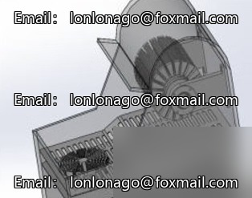
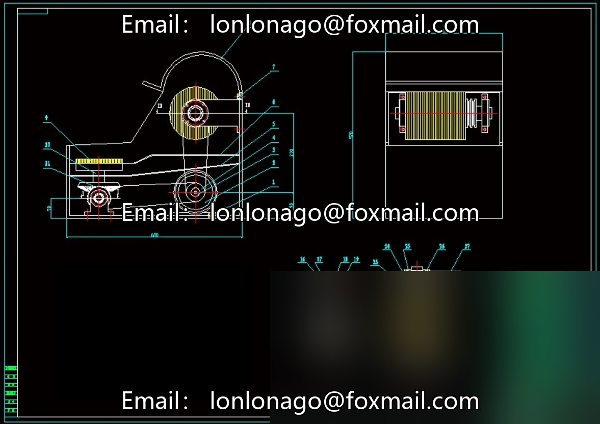
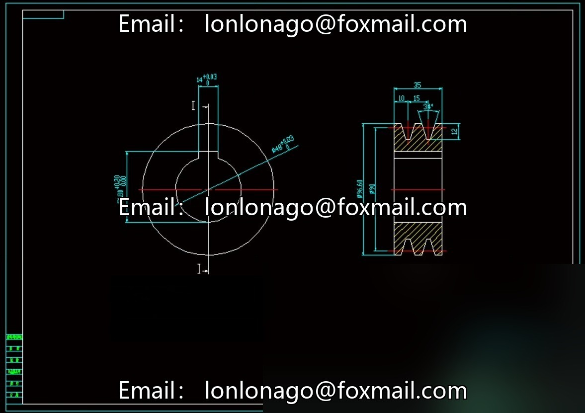
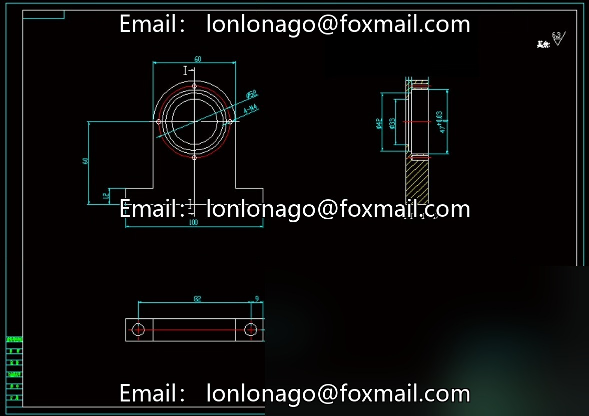
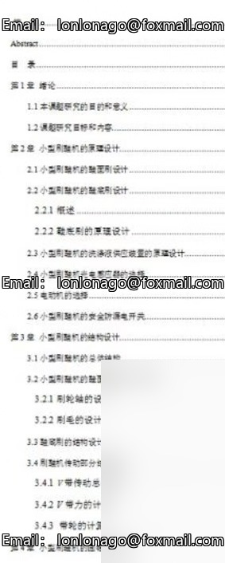

# Mixer design mixer design diagram mixer design CAD diagram

## Body

Mixer design mixer design diagram mixer design CAD diagram
The flocculation tank (usually referred to as the reaction tank) completing the flocculation process plays an important role in water treatment.
Suspended and fleshy substances in natural water have particle sizes that are extremely fine.
To remove these substances, traditionally they are typically achieved by means of concrete curing. In other words, appropriately add coagulants to the original water. After sufficient mixing Imparting colloidal stability against (decomposition of) instability and adsorbing with polymeric substances after coagulation agent water mixing. Making the particles have flocculating performance.
The purpose of the flocculation pond is to create suitable hydraulic conditions so that particles with flocculation properties aggregate through mutual contact, forming larger flocculent bodies (flocs).

Therefore, the suitability of the flocculator design determines the flocculation effect, which directly affects the precipitation effect of subsequent processing.
The flocculator mixer is a mechanical stirring device for the flocculator tank, mainly used for stirring in wastewater treatment processes.
This design mentions the design of the flocculator tank, the design of the mixer, and its process flow.
362

The design covers stirrer design, stirrer design drawings and CAD; it also includes flocculent pool, stirrer machine, process flow and related technical drawings.

<!-- AI_ENRICHED -->

## Images

## Payment

Here is a pay link on Stripe ( https://buy.stripe.com/3cs8yP7sY87d0vu9AB ). Please contact me lonlonago@foxmail.com after funding $89, and I will send you a complete data files , thank you!

